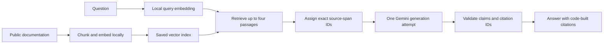

# RAG Study Buddy

[](https://github.com/nhbl-ai/rag-study-buddy/actions/workflows/ci.yml)

A documentation Q&A web app that retrieves evidence locally, generates an answer with **at most one Gemini API request per question**, and builds source citations in code.

The project explores a practical trade-off: reducing agent/tool-call overhead while retaining inspectable evidence, strict output validation and isolated conversation state.

## Features

- Search a selectable library of three public LangChain documentation pages.
- Run document/query embeddings locally with Ollama and reuse a saved vector index.
- Generate structured answers using Gemini's native JSON-schema output.
- Validate source-span IDs and create citation links from the actual retrieved evidence.
- Inspect passages through an evidence panel, citation popovers and source links.
- Keep conversation/evidence state separate between browser sessions.
- Share a process-local request allowance across sessions; disable automatic generation retries and function-calling loops.

## Architecture



The active service is `src/rag_study_buddy/gemini_rag.py`. The earlier four-subagent Ollama workflow remains on `feat-ollama` and in the legacy module for comparison and regression testing.

## Requirements

- **Python 3.13**; live development/benchmarking was performed on Windows.
- [Ollama](https://ollama.com/download) with the local `embeddinggemma:300m` model.
- A Gemini API key with access to the configured chat model. The default is `gemini-3.5-flash-lite`; availability and quotas depend on the account.
- Internet access for Gemini generation and downloading the bundled documentation during preparation.

Local embeddings can run on CPU. Browser clients do not need a model installation. This setup is a local prototype, rather than a production hosting configuration.

## Quick start on Windows

Install Python and Ollama first, then open PowerShell:

```powershell
git clone https://github.com/nhbl-ai/rag-study-buddy.git
cd rag-study-buddy
py -3.13 -m venv .venv
.\.venv\Scripts\python.exe -m pip install -r requirements.txt
if (!(Test-Path .env)) { Copy-Item .env.example .env }
```

Edit the local `.env` and set `GEMINI_API_KEY`. `GOOGLE_API_KEY` is also accepted. Keep the file local; do not paste credentials into issues, screenshots or commits.

Start the Ollama desktop application, or run `ollama serve` in another terminal, then download the embedding model:

```powershell
ollama pull embeddinggemma:300m
```

Start the web app:

```powershell
.\.venv\Scripts\python.exe -m streamlit run streamlit_app.py
```

Open **http://127.0.0.1:8501**. Select documents, prepare the index and ask a question. Preparation downloads the selected documentation; later questions reuse the index. The first UI render does not call Gemini or download documents.

The terminal sample uses the same single-request service:

```powershell
.\.venv\Scripts\python.exe -m src.rag_study_buddy.gemini_agent
```

### macOS and Linux command equivalents

Use Python 3.13 and start the installed Ollama service:

```bash
python3.13 -m venv .venv
.venv/bin/python -m pip install -r requirements.txt
# Copy only when .env does not already exist:
test -e .env || cp .env.example .env
ollama pull embeddinggemma:300m
.venv/bin/python -m streamlit run streamlit_app.py
```

CI runs offline regressions on Ubuntu and Windows. The published live-inference measurements are from the Windows benchmark environment.

## Configuration

See [.env.example](.env.example). Main settings:

| Variable | Default | Purpose |
|---|---|---|
| `GEMINI_API_KEY` | Required for generation | Server-side API credential |
| `GEMINI_CHAT_MODEL` | `gemini-3.5-flash-lite` | Answer generation model |
| `GEMINI_TIMEOUT_SECONDS` | `60` | Timeout for the generation request |
| `GEMINI_REQUESTS_PER_MINUTE` | `12` | Process-local rolling admission allowance |
| `GEMINI_QUOTA_GROUP` | `default-project` | Shared project group for consistently configured sessions/keys |
| `OLLAMA_BASE_URL` | `http://127.0.0.1:11434` | Local embedding server |
| `OLLAMA_EMBEDDING_MODEL` | `embeddinggemma:300m` | Local embedding model |
| `OLLAMA_TIMEOUT_SECONDS` | `180` | Local embedding timeout |
| `OLLAMA_EMBEDDING_GPU_LAYERS` | Blank | Automatic placement; `0` requests CPU embeddings |

Use the standard Ollama service for the quick start. The optional Windows helper `scripts/start_ollama.ps1` uses a separate repository-local model directory under ignored `work/`; models downloaded into the standard store are not automatically copied there.

## Request and citation guarantees

For a question with retrieved evidence, the intended successful path contains **one local embedding request and one Gemini generation request**. The local request does not consume Gemini quota. Empty retrieval uses zero Gemini requests. A user-initiated retry is a new question attempt.

The app splits source passages into exact spans, constrains output to their IDs and requires support for every claim. Code rejects malformed output, unknown supports and model-written citation links, then builds links using the current turn's evidence anchors. Failed output is not automatically regenerated, and unchecked drafts are not published.

These checks establish provenance and citation structure, **not semantic entailment**. A valid citation can still be attached to an incorrect interpretation. Inspect the evidence and evaluate answer quality separately from retrieval quality.

The request allowance is shared within one Python process. It does not coordinate multiple servers, other applications using the project, input-token quotas or daily quotas. Provider quota failures are shown without automatic retry.

## Measured results

A saved-index experiment submitted five different questions concurrently through five independent RAG sessions:

| Measurement | Final validation burst |
|---|---:|
| Completed workflows with valid own-session citation links | **5 / 5** |
| Gemini generation HTTP requests | **5 total; 1 per question** |
| Local question embedding requests | **5** |
| Generation retries / HTTP 429 / timeouts | **0 / 0 / 0** |
| Per-question latency | **2.03-2.95 seconds** |
| Total chat tokens | **10,277** |

An earlier successful burst took **8.93-15.47 seconds per question**. These are small, saved-index measurements with five service sessions, not production capacity guarantees, five real browser load tests, or a promise of three-second answers.

Read [the full single-request validation](docs/gemini-single-request-validation.md), [the earlier agentic Gemini comparison](docs/gemini-api-one-two-users.md) and [the local Ollama experiments](docs/ollama-validation.md).

## Tests and CI

Run offline regressions without API keys, downloaded models or a running Ollama server:

```powershell
.\.venv\Scripts\python.exe -m unittest discover -s tests -v
.\.venv\Scripts\python.exe -m pip check
```

The suite covers one-call generation, withheld invalid citations, abstention, cross-session evidence isolation, safe errors, cache behavior, shared admission and Streamlit interactions. CI installs the dependencies and runs these checks on Python 3.13 for Ubuntu and Windows. CI does not make live Gemini requests or download models/documents.

To reproduce the live benchmark, first prepare a matching local index, then choose a fresh output directory:

```powershell
.\.venv\Scripts\python.exe scripts/benchmark_gemini_single.py --index data/processed/<your-index>.json --output work/benchmark-run --users 5
```

Replace `<your-index>` with the index created by preparation. This command makes real API calls. The benchmark verifies the embedding model/content identity and accepts only the bundled public-documentation corpus. Indexes, models and raw results remain ignored by Git.

## Scope and limitations

- The document library is fixed; uploads, authentication and persistent chat storage are not implemented.
- Questions and retrieved source spans are sent to Gemini. Use appropriate documents and review provider terms before handling confidential content.
- Answers are English. Context consists of recent user questions, with old assistant answers excluded as evidence.
- The older `agent.py` terminal entry point runs the legacy Ollama flow. Use `gemini_agent` for the active workflow.
- No production deployment or maximum simultaneous-user count is claimed.

## Attribution

Built with LangChain, Deep Agents, Streamlit, Ollama and the Gemini API. The learning prototype was inspired by [langchain-ai/rag-from-scratch](https://github.com/langchain-ai/rag-from-scratch). Runtime documentation content remains attributed through its source URLs.
