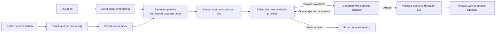

# RAG Study Buddy

[](https://github.com/nhbl-ai/rag-study-buddy/actions/workflows/ci.yml)

A documentation Q&A web app that retrieves evidence locally, switches generation providers on quota errors or timeouts, and builds source citations in code.

The project explores a practical trade-off: reducing agent/tool-call overhead while retaining inspectable evidence, strict output validation and isolated conversation state.

## Features

- Search a selectable library of three public LangChain documentation pages.
- Run document/query embeddings locally with Ollama and reuse a saved vector index.
- Generate structured answers with Gemini, Groq or Cloudflare Workers AI, in configurable priority order.
- Validate source-span IDs and create citation links from the actual retrieved evidence.
- Inspect passages through an evidence panel, citation popovers and source links.
- Keep conversation/evidence state separate between browser sessions.
- Share Gemini's request allowance and provider cooldowns across sessions in the same process.

## Architecture



The active service is `src/rag_study_buddy/gemini_rag.py`. The earlier four-subagent Ollama workflow remains available in the legacy modules for comparison and regression testing. Its experiment is recorded in the history of `feat-ollama`.

### Smart Study Planner

This branch provides the Python RAG portion of the planner repository. Keep `src/`, `tests/` and `rag.toml` at the repository root alongside `smart-study-planner-backend/`. The included entry points are Streamlit and the terminal sample. A Planner HTTP adapter and permission-scoped document retrieval are separate integration work.

## Requirements

- **Python 3.13**; live development/benchmarking was performed on Windows.
- [Ollama](https://ollama.com/download) with the local `embeddinggemma:300m` model.
- Credentials for at least one of Gemini, Groq or Cloudflare Workers AI, with access to its configured model.
- Internet access for answer generation and for downloading the bundled documentation during preparation.

Local embeddings can run on CPU. Browser clients do not need a model installation. This setup is a local prototype, rather than a production hosting configuration.

## Quick start on Windows

Install Python and Ollama first, then open PowerShell:

```powershell
git clone --branch codex/smart-study-planner-rag https://github.com/nhbl-ai/rag-study-buddy.git
cd rag-study-buddy
py -3.13 -m venv .venv
.\.venv\Scripts\python.exe -m pip install -r requirements.txt
if (!(Test-Path .env)) { Copy-Item .env.example .env }
```

Edit the local `.env` and fill in the credentials for the providers you want to use. Leave unused keys blank. The default order in `rag.toml` is Gemini, Groq, then Cloudflare Workers AI.

```dotenv
GEMINI_API_KEY=
GROQ_API_KEY=
CLOUDFLARE_API_TOKEN=
CLOUDFLARE_ACCOUNT_ID=
```

- **Gemini** accepts `GOOGLE_API_KEY` as a fallback credential when `GEMINI_API_KEY` is blank.
- **Groq** uses a GroqCloud project key. If you change `GROQ_CHAT_MODEL`, choose a model that supports strict Structured Outputs. [Create a Groq key](https://console.groq.com/keys) · [Supported Groq models](https://console.groq.com/docs/structured-outputs)
- **Cloudflare Workers AI** uses the Workers AI REST API. In the Cloudflare dashboard, open Workers AI and select **Use REST API** to create a Workers AI API token and copy the Account ID. If you change `CLOUDFLARE_CHAT_MODEL`, choose a Workers AI model that supports JSON Mode. [Get a token and Account ID](https://developers.cloudflare.com/workers-ai/get-started/rest-api/) · [Workers AI JSON Mode](https://developers.cloudflare.com/workers-ai/features/json-mode/)

Keep `.env` local. Restart Streamlit after editing it or `rag.toml`.

Start the Ollama desktop application, or run `ollama serve` in another terminal, then download the embedding model:

```powershell
ollama pull embeddinggemma:300m
```

If you change `OLLAMA_EMBEDDING_MODEL` in `rag.toml`, pull that model instead and prepare the documents again.

Start the web app:

```powershell
.\.venv\Scripts\python.exe -m streamlit run streamlit_app.py
```

Open **http://127.0.0.1:8501**. Select documents, prepare the index and ask a question. Preparation downloads the selected documentation and later questions reuse the index. The first UI render makes no API or document requests. The conversation shows which provider generated each answer.

The terminal sample uses the same provider order:

```powershell
.\.venv\Scripts\python.exe -m src.rag_study_buddy.gemini_agent
```

### macOS and Linux command equivalents

Use Python 3.13 and start the installed Ollama service:

```bash
python3.13 -m venv .venv
.venv/bin/python -m pip install -r requirements.txt
# Copy only when .env does not already exist:
test -e .env || cp .env.example .env
ollama pull embeddinggemma:300m
.venv/bin/python -m streamlit run streamlit_app.py
```

CI runs offline regressions on Ubuntu and Windows. The published live-inference measurements are from the Windows benchmark environment.

## Configuration

Edit [rag.toml](rag.toml) at the repository root for both the Streamlit app and terminal sample. For example, the following settings use Gemini exclusively with six requests per rolling minute and up to three retrieved passages per question.

```toml
RAG_PROVIDER_ORDER = "gemini"
GEMINI_REQUESTS_PER_MINUTE = 6
RAG_RETRIEVAL_TOP_K = 3
```

Configuration precedence is process environment, local `.env`, `rag.toml`, then built-in defaults. If you already have runtime settings in `.env`, remove the corresponding lines to manage those settings in `rag.toml`. Copy [.env.example](.env.example) for credential names, including `CLOUDFLARE_ACCOUNT_ID` and the optional `GOOGLE_API_KEY` fallback for Gemini.

| Setting | Default | Purpose |
|---|---|---|
| `RAG_PROVIDER_ORDER` | `gemini,groq,cloudflare` | Comma-separated priority. Omit a provider to disable it |
| `RAG_RETRIEVAL_TOP_K` | `4` | Maximum retrieved passages per question |
| `RAG_MAX_OUTPUT_TOKENS` | `2048` | Output token cap applied to each generation provider |
| `GEMINI_CHAT_MODEL` | `gemini-3.5-flash-lite` | Answer generation model |
| `GEMINI_TIMEOUT_SECONDS` | `60` | Timeout for the generation request |
| `GEMINI_REQUESTS_PER_MINUTE` | `12` | Process-local rolling admission allowance |
| `GEMINI_QUOTA_GROUP` | `default-project` | Shared project group for consistently configured sessions/keys |
| `GROQ_CHAT_MODEL` | `openai/gpt-oss-20b` | Groq model with strict Structured Outputs |
| `GROQ_TIMEOUT_SECONDS` | `60` | Timeout for a Groq request |
| `CLOUDFLARE_CHAT_MODEL` | `@cf/meta/llama-3.3-70b-instruct-fp8-fast` | Workers AI model with JSON Mode |
| `CLOUDFLARE_TIMEOUT_SECONDS` | `60` | Timeout for a Workers AI request |
| `OLLAMA_BASE_URL` | `http://127.0.0.1:11434` | Local embedding server |
| `OLLAMA_EMBEDDING_MODEL` | `embeddinggemma:300m` | Local embedding model |
| `OLLAMA_TIMEOUT_SECONDS` | `180` | Local embedding timeout |
| `OLLAMA_EMBEDDING_GPU_LAYERS` | Omitted | Automatic placement. Set `0` to request CPU embeddings |

Use positive integers for request, passage and token counts. Timeouts accept positive numbers in seconds. The Gemini allowance counts generation requests across sessions in one Python process for the configured quota group and model. It is independent of provider-side quotas and Planner per-user traffic limits.

Use the standard Ollama service for the quick start. The optional Windows helper `scripts/start_ollama.ps1` uses a separate repository-local model directory under ignored `work/`; models downloaded into the standard store are not automatically copied there.

## Request and citation guarantees

Each question runs one local retrieval. A question uses one generation request when the first available provider succeeds. Empty retrieval uses zero generation requests. A provider can receive at most one generation request per question.

The app immediately tries the next available provider after HTTP 429, depleted Gemini prepaid credits (HTTP 402), a client-side request timeout, or HTTP 408 or 504. A timeout affects the current question. The next question starts from the configured priority. If no provider can answer, the app asks the user to try again later. Other API and answer-validation errors are surfaced immediately.

The app skips a provider during its quota cooldown and skips Gemini when the local allowance is full and another provider is configured. With Gemini alone, the local allowance queues requests. Cooldowns use the provider's retry delay if available and otherwise last 60 seconds for HTTP 429 or five minutes for Gemini HTTP 402.

The app splits source passages into exact spans and requires support for every claim. Code rejects malformed output, unknown supports and model-written citation links, then builds links using the current turn's evidence anchors. All providers use the same validation before publication.

These checks establish provenance and citation structure, **not semantic entailment**. A valid citation can still be attached to an incorrect interpretation. Inspect the evidence and evaluate answer quality separately from retrieval quality.

The local allowance and cooldowns are shared within one Python process. External usage, token quotas and daily limits are detected when a provider rejects a request.

## Measured results

A saved-index experiment submitted five different questions concurrently through five independent RAG sessions:

| Measurement | Final validation burst |
|---|---:|
| Completed workflows with valid own-session citation links | **5 / 5** |
| Gemini generation HTTP requests | **5 total; 1 per question** |
| Local question embedding requests | **5** |
| Generation retries / HTTP 429 / timeouts | **0 / 0 / 0** |
| Per-question latency | **2.03-2.95 seconds** |
| Total chat tokens | **10,277** |

An earlier successful burst took **8.93-15.47 seconds per question**. These are small, saved-index measurements with five service sessions, not production capacity guarantees, five real browser load tests, or a promise of three-second answers.

Read [the full single-request validation](docs/gemini-single-request-validation.md), [the earlier agentic Gemini comparison](docs/gemini-api-one-two-users.md) and [the local Ollama experiments](docs/ollama-validation.md).

## Tests and CI

Run offline regressions without API keys, downloaded models or a running Ollama server:

```powershell
.\.venv\Scripts\python.exe -m unittest discover -s tests -v
.\.venv\Scripts\python.exe -m pip check
```

The suite covers one-call generation, quota and timeout failover with mocked HTTP transport, withheld invalid citations, abstention, cross-session evidence isolation, safe errors, cache behavior, shared admission and Streamlit interactions. CI installs the dependencies and runs these checks offline on Python 3.13 for Ubuntu and Windows.

To reproduce the live benchmark, first prepare a matching local index, then choose a fresh output directory:

```powershell
.\.venv\Scripts\python.exe scripts/benchmark_gemini_single.py --index data/processed/<your-index>.json --output work/benchmark-run --users 5
```

Replace `<your-index>` with the index created by preparation. This benchmark uses Gemini exclusively and makes real API calls. It verifies the embedding model/content identity and accepts only the bundled public-documentation corpus. Indexes, models and raw results remain ignored by Git.

## Scope and limitations

- The document library is fixed; uploads, authentication and persistent chat storage are not implemented.
- Questions and retrieved source spans are sent to each generation provider attempted for that question.
- Answers are English. Context consists of recent user questions, with old assistant answers excluded as evidence.
- The older `agent.py` terminal entry point runs the legacy Ollama flow. Use `gemini_agent` for the active workflow.
- No production deployment or maximum simultaneous-user count is claimed.

## Attribution

Built with LangChain, Deep Agents, Streamlit, Ollama and the Gemini API. The learning prototype was inspired by [langchain-ai/rag-from-scratch](https://github.com/langchain-ai/rag-from-scratch). Runtime documentation content remains attributed through its source URLs.
